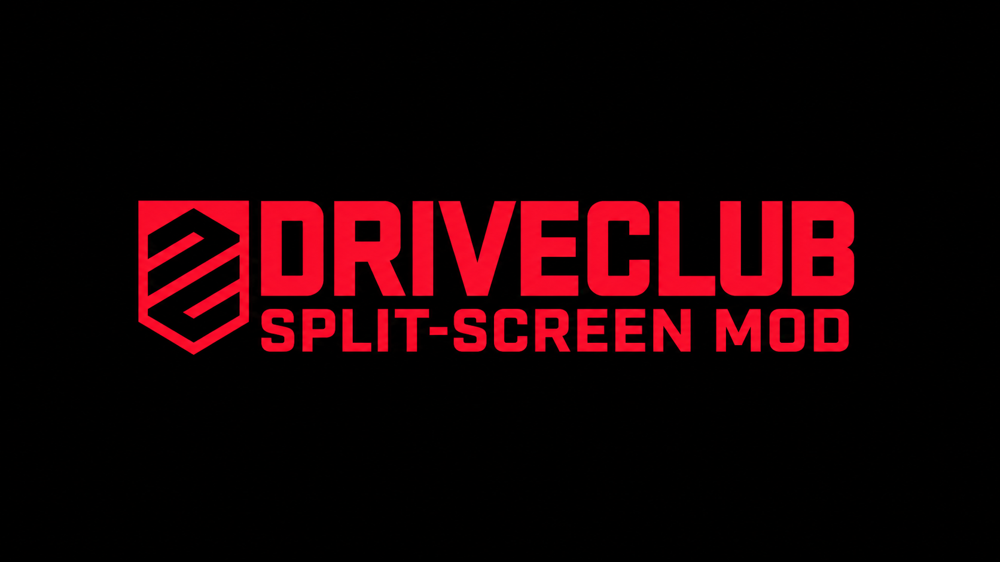

# DRIVECLUB — Split Screen Mod

Race with a friend on the same PC. Player 1 uses the upper half of the screen and player 2 uses the lower half. Each player chooses a car.

  

**[Download Mod](https://github.com/nuvsyakoetakoe/driveclub-split-screen/releases/latest/download/DRIVECLUB-Split-Screen-0.1.0-Windows-x64.zip)** · [Installation](#installation) · [Report a bug](#report-a-bug) · **[Русский](docs/README.ru.md)**

## Features

- Two-player local racing on one display.
- Separate car selection for each player.
- Custom player names and input device assignments.
- Configurable keyboard bindings.
- Country, track, weather and event settings through the game menus.
- English and Russian mod interfaces.

## Requirements

Windows x64, **DRIVECLUB port 0.4.2**, and an installed copy of **CUSA00003 with game update 1.28**. On a fresh installation, complete the initial setup and start a normal race once.

## Installation

1. Close the game and its launcher.
2. Download **DRIVECLUB-Split-Screen-0.1.0-Windows-x64.zip** from [Releases](https://github.com/nuvsyakoetakoe/driveclub-split-screen/releases/latest).
3. Extract the ZIP to a separate folder. Keep the installer for removal.
4. Open **SplitScreen-Setup.exe**, click **Install**, and select **DriveClub.exe** in your port installation. Setup backs up the original launcher.
5. After setup confirms installation, start the game through the same **DriveClub.exe**.

## Start a race

1. Open **Drive → Split Screen**.
2. In **Split Screen settings**, choose player names, input devices and keyboard bindings. A keyboard and a gamepad can be used together.
3. Select **Race**, choose the country, track, environment and event settings, then select **Play**.
4. Player 1 chooses a car first, followed by player 2. The race then loads.

## Language

Setup opens in English. Select **Русский** in the language list for Russian.

The mod uses Russian when the launcher's game language is Russian and English for every other selection. You can change the game language between launches without reinstalling. The game's own screens continue to use the selected game language.

## Uninstall

Close the game and launcher. Open **SplitScreen-Setup.exe**, click **Uninstall**, and select the same **DriveClub.exe**. Setup restores the original launcher. Your saves and Split Screen player settings are kept.

## Report a bug

[Open a bug report](https://github.com/nuvsyakoetakoe/driveclub-split-screen/issues/new?template=bug_report.yml). Include the mod and port versions, track, graphics settings, input devices and steps to reproduce the problem. Attach a screenshot or video if possible.

## Credits and license

Original mod by **[nuvsyakoetakoe](https://github.com/nuvsyakoetakoe)**. Copyright © 2026 nuvsyakoetakoe.

The original Split Screen code is licensed under **[GNU GPL version 2 only](LICENSE)**. The launcher incorporates code from [DRIVECLUB Recomp](https://github.com/OverkillLabs3/driveclub-recomp), whose [license](research/upstream/driveclub-042/LICENSE) is preserved. Third-party components retain their own copyright notices and licenses. DRIVECLUB and its game assets belong to their respective rights holders.

[Build from source](BUILD.txt) · [English installation instructions](README-en.txt) · [Русская инструкция](README-ru.txt)

This mod is provided “as is”, without any warranty that it will work on your system.
