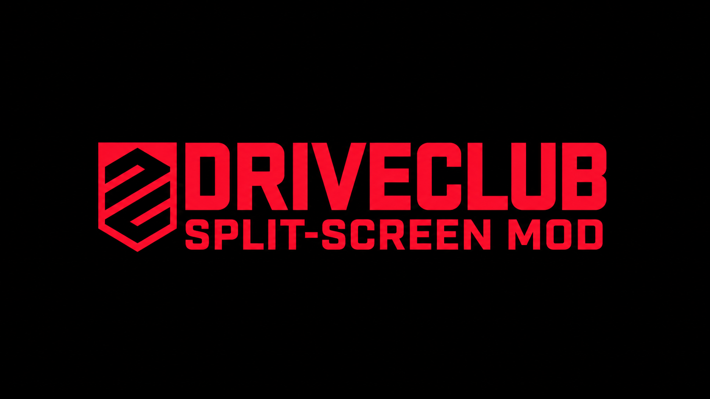

# DRIVECLUB — Split Screen Mod

Гоняйте вдвоём на одном компьютере. Первый игрок видит верхнюю половину экрана, второй — нижнюю. Каждый выбирает свою машину.

  

**[Скачать мод](https://github.com/nuvsyakoetakoe/driveclub-split-screen/releases/latest/download/DRIVECLUB-Split-Screen-0.1.0-Windows-x64.zip)** · [Установка](#установка) · [Сообщить об ошибке](#сообщить-об-ошибке) · **[English](../README.md)**

## Возможности

- Локальная гонка для двух игроков на одном экране.
- Отдельный выбор машины для каждого игрока.
- Настройка имён и устройств ввода.
- Назначение клавиш клавиатуры.
- Выбор страны, трассы, погоды и параметров заезда через игровое меню.
- Интерфейс мода на русском и английском.

## Требования

Windows x64, **порт DRIVECLUB 0.4.2**, установленная игра **CUSA00003 с обновлением 1.28**. Если порт только что установлен, пройдите первоначальную настройку и один раз откройте обычный заезд.

## Установка

1. Закройте игру и лаунчер.
2. Скачайте **DRIVECLUB-Split-Screen-0.1.0-Windows-x64.zip** из [последнего релиза](https://github.com/nuvsyakoetakoe/driveclub-split-screen/releases/latest).
3. Распакуйте весь ZIP в отдельную папку. Сохраните установщик для удаления мода.
4. Откройте **SplitScreen-Setup.exe**, выберите **Русский** и нажмите **Установить**.
5. Выберите **DriveClub.exe** в папке порта и дождитесь сообщения об установке. Установщик сохранит резервную копию исходного лаунчера.
6. Откройте тот же **DriveClub.exe** и запустите игру обычным способом.

## Первая гонка

1. В меню **Drive** откройте **Split Screen**.
2. В настройках режима задайте имена, устройства ввода и клавиши. Можно играть с клавиатурой и геймпадом.
3. Выберите **Гонка**, страну, трассу, условия окружающей среды и параметры заезда. Нажмите **Играть**.
4. Сначала машину выбирает первый игрок, затем второй. После этого загружается гонка.

## Язык

Установщик открывается на английском. Для русского интерфейса выберите **Русский** в списке языков.

Мод использует русский язык, если в лаунчере выбран русский, и английский при любом другом выборе. Язык можно сменить перед следующим запуском без переустановки мода. Штатные экраны игры продолжают использовать выбранный язык игры.

## Удаление

Закройте игру и лаунчер. Откройте **SplitScreen-Setup.exe**, выберите **Русский**, нажмите **Удалить** и выберите тот же **DriveClub.exe**. Установщик восстановит исходный лаунчер. Сохранения игры и настройки игроков Split Screen сохранятся.

## Сообщить об ошибке

[Создайте баг-репорт](https://github.com/nuvsyakoetakoe/driveclub-split-screen/issues/new?template=bug_report.yml). Укажите версии мода и порта, трассу, настройки графики, устройства ввода и шаги воспроизведения. По возможности приложите скриншот или видео.

## Авторство и лицензия

Автор оригинального мода — **[nuvsyakoetakoe](https://github.com/nuvsyakoetakoe)**. Copyright © 2026 nuvsyakoetakoe.

Оригинальный код Split Screen распространяется под **[GNU GPL версии 2](../LICENSE)**. Лаунчер включает код [DRIVECLUB Recomp](https://github.com/OverkillLabs3/driveclub-recomp), его [лицензия](../research/upstream/driveclub-042/LICENSE) сохранена. Для сторонних компонентов сохраняются указанные в них авторство и лицензии. Права на DRIVECLUB и материалы игры принадлежат их правообладателям.

[Сборка из исходников](../BUILD.txt) · [Русская инструкция](../README-ru.txt) · [English installation instructions](../README-en.txt)

Мод предоставляется «как есть». Его работоспособность на вашей системе не гарантируется.
